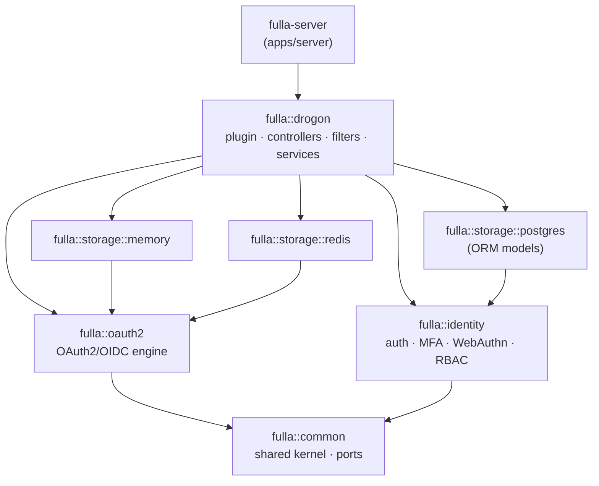
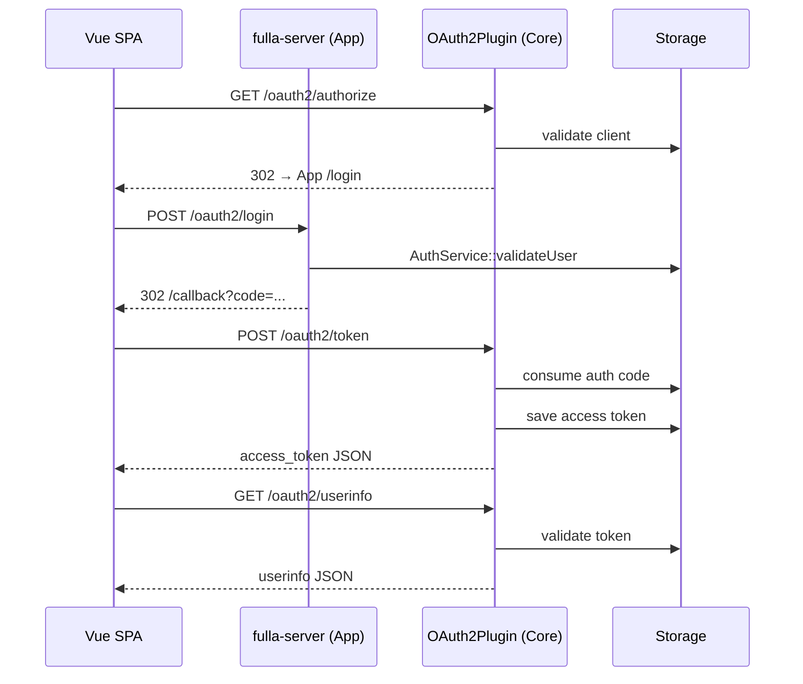

# Architecture Overview

This page summarizes the overall architecture of fulla from four perspectives: technology stack, module layout, request flow, and deployment topology.

## 1. Technology Stack

| Layer | Technology | Purpose |
|---|---|---|
| Web framework | Drogon | High-performance asynchronous C++ HTTP services |
| Primary database | PostgreSQL 17 | Persistence for users, roles, clients, authorization codes, and tokens (deployment default since 2026-08-18; the server also runs on 15 — see [PG Major-Version Upgrade](../operate/postgresql-major-upgrade.md) for the upgrade path) |
| Cache / KV | Redis | Optional L2 cache in front of Postgres (client and access-token read paths); the standalone Redis store is deprecated (rate limiting is implemented in-process and does not depend on Redis) |
| Frontend | Vue 3 + Vite | SPA client for the OAuth2 authorization-code flow |
| Deployment | Docker Compose | Local and production-like full-stack deployment |
| Observability | Prometheus | Metrics collected via the Drogon PromExporter |

## 2. Module Layout

The backend is split into **8 CMake packages** with an enforced dependency direction — the Domain layer (`common` / `oauth2` / `identity`) never depends on Drogon (verified by `tools/arch-guard` in CI). Arrows read "depends on":



How a request flows through those packages:

```text
HTTP request
  |
  |-- fulla-server (apps/server -- authorization-server binary; pure
  |   assembly: bootstrap, config, migrations, OpenAPI)
  |   `-- AuthService: local application login/registration
  |       (libs/drogon/src/AuthService.cc)
  |
  `-- fulla::drogon (libs/drogon -- Drogon adapter/SDK package, target fulla::drogon)
      |-- OAuth2Plugin: initialization & lifecycle management
      |
      |-- Protocol controllers & filters (auto-registered)
      |   |-- AuthorizationEndpointController / TokenEndpointController / DiscoveryController:
      |   |     /oauth2/authorize, /oauth2/token, /.well-known/*, /userinfo
      |   `-- Filters: AuthorizationFilter (admin API: scope gate + RBAC
      |         role/permission gate), OAuth2AuthFilter (user routes)
      |
      |-- Services (HTTP-facing business orchestration)
      |   |-- TokenService (libs/oauth2): PKCE, authorization-code/token
      |   |     generation & exchange
      |   |-- ClientService (libs/oauth2): client credentials & redirect URI checks
      |   `-- IdentityService (libs/drogon/src/services/IdentityService.cc,
      |         namespace fulla::identity): RBAC/scope tiering, subject
      |         mapping, user consent — lives in the adapter layer because it
      |         orchestrates HTTP flows; the identity domain logic and its
      |         repository interfaces (IUserRepository / IRoleRepository /
      |         ISubjectMappingRepository) live in libs/identity
      |
      `-- Storage (repository ports per aggregate, one bundle per backend)
          |-- I{Client,Grant,Token,Consent}Repository: storage ports (libs/oauth2)
          |-- MemoryRepositoryBundle: in-process test storage (libs/storage-memory)
          |-- PostgresRepositoryBundle: persistent storage (libs/storage-postgres;
          |     identity-side persistence in PostgresIdentityRepository)
          `-- RedisRepositoryBundle: Redis storage (libs/storage-redis) — deprecated
```

## 3. Authorization-Code Flow



## 4. Storage Strategy

`OAuth2Plugin` selects the backend according to `storage_type` in `config.json`.

| storage_type | Implementation | Typical use |
|---|---|---|
| memory | `MemoryRepositoryBundle` | Unit tests and fast local demos |
| redis | `RedisRepositoryBundle` | **Deprecated** — logs an ERROR at startup and rejects the `refresh_token` grant with `unsupported_grant_type`; do not use. Redis now serves only as an optional cache layer in front of Postgres (see [Configuration Guide §3](../operate/configuration-guide.md)) |
| postgres | `PostgresRepositoryBundle` | Production persistent storage |

> Each `*RepositoryBundle` assembles the four OAuth2 repository implementations for its backend — client / grant / token / consent (see the headers under each `libs/storage-*/include`). Identity-side persistence (users, roles, subject mappings) lives outside the bundles in `PostgresIdentityRepository` (libs/storage-postgres), consumed through the `libs/identity` repository interfaces.

## 5. Frontend–Backend Integration

The frontend starts the OAuth2 authorization-code flow from the login page: it stores
the CSRF `state` in localStorage, handles `/callback`, exchanges the authorization
code for tokens, and then calls `/oauth2/userinfo`.

For third-party social login, the frontend receives the external authorization code
and submits it to backend endpoints:

- `/api/github/login`
- `/api/google/login`
- `/api/wechat/login`

The enabled set is discoverable via `GET /api/auth/providers` (the login page renders its provider buttons from it).

Token exchange with the provider happens on the server side; provider secrets are never exposed to the browser.

## 6. Deployment Topology

Docker Compose (`deploy/docker/docker-compose.yml`) starts the following by default:

- `fulla-frontend`: port `8080`
- `fulla-admin` (admin console): port `8081`
- `fulla-backend`: port `5555`
- PostgreSQL: host port `5433` (bound to `127.0.0.1`)
- Redis: host port `6380` (bound to `127.0.0.1`)
- Prometheus: port `9090`

For production, terminate TLS at a reverse proxy and proxy API requests to the Drogon
backend (see [Production Deployment](../operate/deployment.md) for the full procedure).
