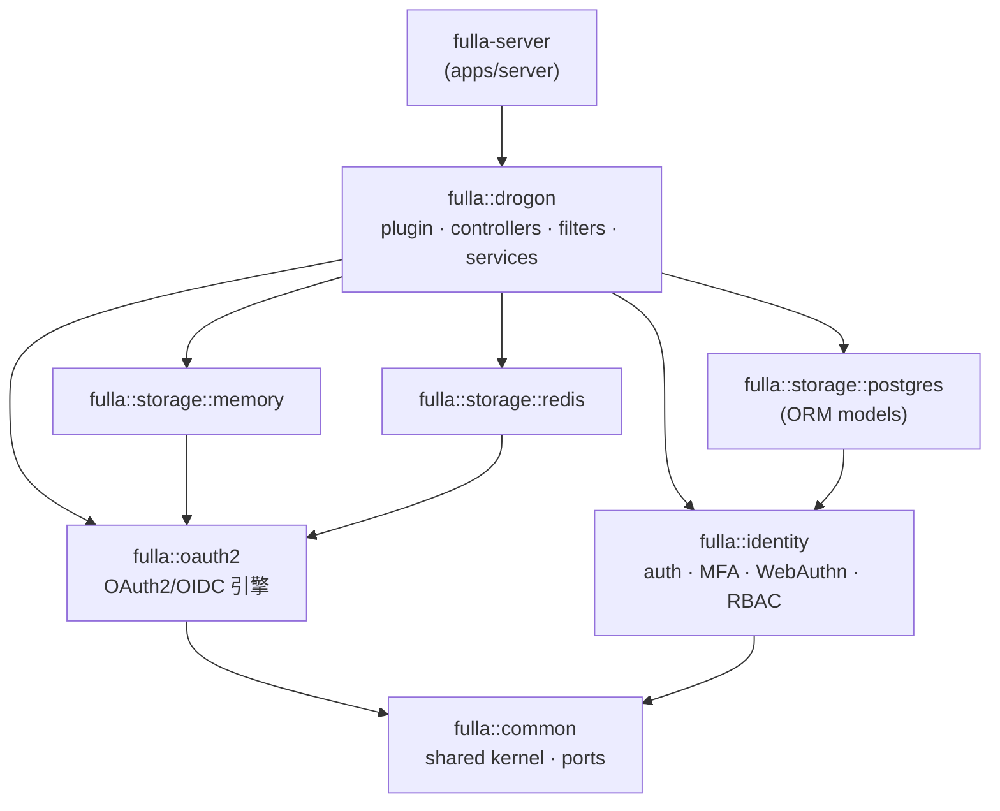
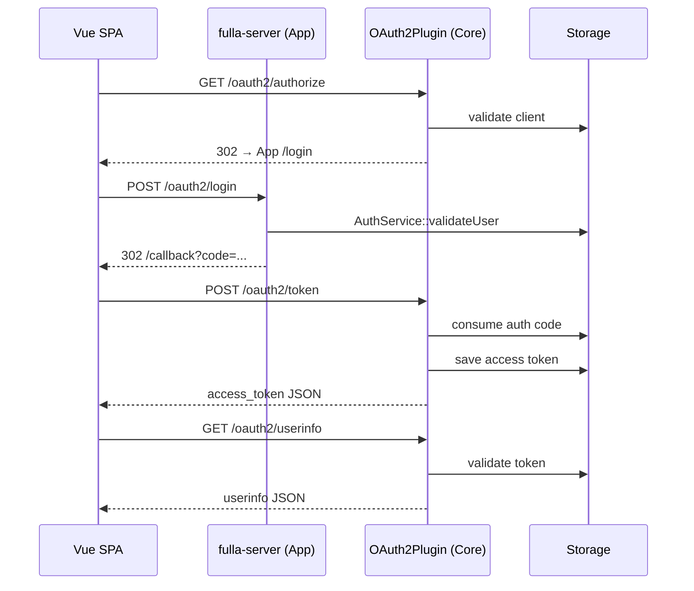

# 架构总览

本文从技术栈、模块布局、请求流转与部署形态四个视角，概括 fulla 的整体架构。

## 1. 技术栈

| 层 | 技术 | 用途 |
|---|---|---|
| Web 框架 | Drogon | 高性能异步 C++ HTTP 服务 |
| 主数据库 | PostgreSQL 17 | 用户、角色、客户端、授权码与令牌的持久化（2026-08-18 起为部署默认；服务端也可运行在 15 上——升级路径见 [PG 大版本升级](../operate/postgresql-major-upgrade.md)） |
| 缓存 / KV | Redis | Postgres 前置的可选 L2 缓存（client 与 access-token 读路径）；独立 Redis 存储已弃用（限流为进程内实现，不依赖 Redis） |
| 前端 | Vue 3 + Vite | OAuth2 授权码流程的 SPA 客户端 |
| 部署 | Docker Compose | 本地与类生产全栈部署 |
| 可观测 | Prometheus | 经 Drogon PromExporter 采集指标 |

## 2. 模块布局

后端拆分为 **8 个 CMake 包**，依赖方向受强制约束——领域层（`common` /
`oauth2` / `identity`）永不依赖 Drogon（由 CI 中的 `tools/arch-guard`
校验）。箭头读作「依赖于」：



一条请求如何流经这些包：

```text
HTTP 请求
  |
  |-- fulla-server（apps/server —— 授权服务器二进制；纯装配层：
  |   bootstrap、配置、迁移、OpenAPI）
  |   `-- AuthService：本地应用登录/注册（libs/drogon/src/AuthService.cc）
  |
  `-- fulla::drogon（libs/drogon —— Drogon 适配/SDK 包，target fulla::drogon）
      |-- OAuth2Plugin：初始化与生命周期管理
      |
      |-- 协议控制器与过滤器（自动注册）
      |   |-- AuthorizationEndpointController / TokenEndpointController / DiscoveryController：
      |   |     处理 /oauth2/authorize、/oauth2/token、/.well-known/*、/userinfo
      |   `-- 过滤器：AuthorizationFilter（admin API：scope 门 + RBAC
      |         角色/权限门）、OAuth2AuthFilter（用户路由）
      |
      |-- 服务层（面向 HTTP 的业务编排）
      |   |-- TokenService（libs/oauth2）：PKCE、授权码/令牌的生成与交换
      |   |-- ClientService（libs/oauth2）：客户端凭据与 redirect URI 校验
      |   `-- IdentityService（libs/drogon/src/services/IdentityService.cc，
      |         命名空间 fulla::identity）：RBAC/scope 分层、subject 映射、
      |         用户同意——因其编排 HTTP 流程而位于适配层；identity 领域
      |         逻辑及其仓储接口（IUserRepository / IRoleRepository /
      |         ISubjectMappingRepository）位于 libs/identity
      |
      `-- 存储层（按聚合定义仓储端口，按后端装配 Bundle）
          |-- I{Client,Grant,Token,Consent}Repository：存储端口（libs/oauth2）
          |-- MemoryRepositoryBundle：进程内测试存储（libs/storage-memory）
          |-- PostgresRepositoryBundle：持久化存储（libs/storage-postgres；
          |     身份侧持久化在 PostgresIdentityRepository）
          `-- RedisRepositoryBundle：Redis 存储（libs/storage-redis）——已弃用
```

## 3. 授权码流程



## 4. 存储策略

`OAuth2Plugin` 依据 `config.json` 中的 `storage_type` 选择后端。

| storage_type | 实现 | 典型用途 |
|---|---|---|
| memory | `MemoryRepositoryBundle` | 单元测试与本地快速演示 |
| redis | `RedisRepositoryBundle` | **已弃用**——启动时打 ERROR 日志，并以 `unsupported_grant_type` 拒绝 `refresh_token` 授权；不要使用。Redis 现在仅作为 Postgres 前置的可选缓存层（见[配置指南 §3](../operate/configuration-guide.md)） |
| postgres | `PostgresRepositoryBundle` | 生产持久化存储 |

> 每个 `*RepositoryBundle` 装配同一后端下的四个 OAuth2 仓储实现——client / grant / token / consent（见各 `libs/storage-*/include` 下的头文件）。身份侧持久化（用户、角色、subject 映射）在 Bundle 之外，位于 `PostgresIdentityRepository`（libs/storage-postgres），经 `libs/identity` 的仓储接口消费。

## 5. 前后端集成

前端从登录页发起 OAuth2 授权码流程：将 CSRF `state` 存于 localStorage，
处理 `/callback`、用授权码换取令牌，随后调用 `/oauth2/userinfo`。

第三方社交登录时，前端接收外部授权码后提交给后端端点：

- `/api/github/login`
- `/api/google/login`
- `/api/wechat/login`

启用的 provider 集合可经 `GET /api/auth/providers` 发现（登录页据此渲染 provider 按钮）。

与 provider 的令牌交换在服务端完成，provider 密钥不暴露给浏览器。

## 6. 部署形态

Docker Compose（`deploy/docker/docker-compose.yml`）默认启动：

- `fulla-frontend`：端口 `8080`
- `fulla-admin`（管理后台）：端口 `8081`
- `fulla-backend`：端口 `5555`
- PostgreSQL：宿主端口 `5433`（绑定 `127.0.0.1`）
- Redis：宿主端口 `6380`（绑定 `127.0.0.1`）
- Prometheus：端口 `9090`

生产环境建议在反向代理终结 TLS，再将 API 请求代理到 Drogon 后端
（完整步骤见[生产部署](../operate/deployment.md)）。
