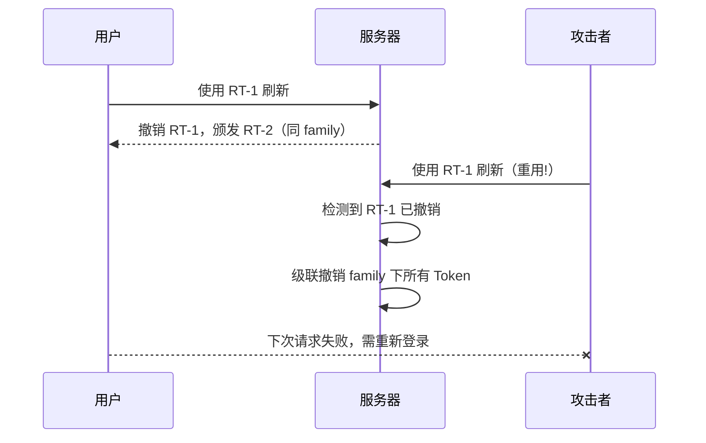

# OAuth2 安全架构设计 (Security Architecture)

本文档详细描述了本系统的安全威胁模型及相应的防御机制，涵盖 Token 生命周期管理、加密存储及防攻击策略。

## 1. 威胁模型与防御 (Threat Model)

| 威胁类型 | 描述 | 防御机制 | 对应文档 |
|----------|------|----------|----------|
| **Replay Attack** (重放攻击) | 攻击者截获 Auth Code 并在合法客户端之前或之后尝试兑换。 | **Atomic Consume** (原子消费) + **One-Time Use Enforcement**。 | [Data Consistency](data-persistence.md) |
| **Credential Leakage** (凭据泄露) | 数据库被拖库导致 Client Secret 泄露。 | **SHA256 Salted Hash**。数据库仅存 Hash 值，绝不存明文。 | [Data Persistence](data-persistence.md) |
| **Token Theft** (令牌窃取) | Access Token 被截获。 | **Short-lived Token** (1小时) + **Refresh Token Rotation** (轮转机制)。 | 本文档 |
| **CSRF** | 攻击者诱导用户进行非预期的授权。 | OAuth 客户端必须校验返回的 **state**；第三方登录当前另有限制，见下文。 | [API Reference](../domains/api-reference.md) |

### 当前第三方登录限制

GitHub/Google/微信登录发现流程当前生成的地址不含绑定浏览器的 state，
不能把上表的 OAuth 客户端 state 要求理解为这些扩展端点已具备同等保护。
加固工作见 [issue #249](https://github.com/voidvec/fulla/issues/249)；
需要登录 CSRF 防护的部署应先关闭这些提供方，直到绑定 state 的流程完成并验证。
账号绑定采用独立的一次性 state 流程。

## 2. Token 生命周期管理

### 2.1 Access Token

- **有效期**: 1小时。
- **用途**: 访问受保护资源（如 `/userinfo`）。
- **验证**: 无状态（JWT）或有状态（DB 查询）。本项目采用 **有状态** 验证，支持即时撤销。

### 2.2 Refresh Token

- **有效期**: 30天。
- **用途**: 在 Access Token 过期后换取新 Token。
- **安全机制: 轮转 (Rotation)**
  - 每次刷新时，不仅颁发新的 Access Token，也会 **颁发新的 Refresh Token**。
  - 旧的 Refresh Token 立即失效。
  - **检测机制**: 如果检测到旧 Refresh Token 被再次使用，系统可视为 Token 泄露，并级联撤销该 `token_family` 下的所有关联 Token（已实现，见 §7.2）。

## 3. 密钥管理 (Secrets Management)

### 3.1 Client Secrets

- **存储**: `sha256(secret + salt)`
- **传输**: 仅通过 HTTPS，使用客户端配置的认证方式（HTTP Basic 或支持时的 POST body secret）。

### 3.2 配置文件

- 敏感信息（如 DB 密码、Redis 密码）建议通过 **环境变量** 注入，而非硬编码在 `config.json` 中。
- 生产环境部署时，应确保配置文件权限严格限制。

## 4. 最佳实践建议

- **HTTPS**: 生产环境 **必须** 启用 HTTPS/TLS，否则 OAuth2 毫无安全性可言。
- **PKCE**: 对于移动端/SPA 客户端，建议开启 PKCE (Proof Key for Code Exchange) 模式（本后端已实现并对 PUBLIC 客户端默认强制启用，支持 `plain` 与 `S256`）。
- **IP 白名单**: 对于高权限 Client，建议限制 Token 兑换的源 IP。

## 5. Token 存储安全 (Token Storage)

所有 Token（Access Token、Refresh Token）在数据库中 **仅存储 SHA-256 哈希值**，绝不存储明文。

- **存储格式**: `SHA-256(token_value)`
- **验证流程**: 客户端提交 Token → 服务端计算哈希 → 与数据库哈希比对
- **优势**: 即使数据库泄露，攻击者无法还原出有效 Token

## 6. 密码哈希策略 (Password Hashing)

### 6.1 当前标准 (OWASP 2023)

- **算法**: PBKDF2-SHA256
- **迭代次数**: 310,000 次（符合 OWASP 2023 推荐）
- **Salt**: 每用户独立随机 Salt（16 字节）
- **输出**: 32 字节密钥

### 6.2 遗留密码迁移

旧版 SHA-256 哈希**默认拒绝**，密码正确也不能登录。全部发行配置及缺省的
`auth.allow_legacy_hash` 都关闭迁移窗口。策略拒绝不增加账号锁定计数，
客户端仍收到通用认证失败。

可使用现有邮箱重置或管理员触发的密码重置流程写入 PBKDF2；需要验证旧密码的
改密路径不能用于迁移。Bootstrap 会复用已有管理员记录，
`FULLA_BOOTSTRAP_ADMIN_PASSWORD` 不会重置该记录。

运维可显式开启临时的 `auth.allow_legacy_hash` 窗口，**仅身份域登录路径**
会在旧格式验证成功后尝试 PBKDF2 重哈希。Drogon 的 `PasswordHasher` 辅助类
始终拒绝旧格式，不能认为窗口适用于全部密码校验路径。关闭窗口前应确认旧记录
已全部迁移。详见[遗留密码迁移](../operate/configuration-guide.md)。

## 7. Refresh Token 轮转与家族追踪 (Refresh Token Rotation)

### 7.1 家族追踪机制 (Family-Based Tracking)

每个 Refresh Token 链共享一个 `token_family` 标识符：

- 首次颁发 RT 时生成唯一 `token_family` ID
- 后续轮转的 RT 继承同一 `token_family`
- 系统可追踪整个 Token 链的生命周期

### 7.2 重用检测与级联撤销

当检测到已撤销的 Refresh Token 被再次使用时：

1. **检测**: 收到的 RT 在数据库中标记为已撤销
2. **判定**: 视为 Token 泄露（攻击者持有旧 RT）
3. **响应**: 级联撤销该 `token_family` 下的 **所有** Token
4. **结果**: 合法用户和攻击者均需重新认证

### 7.3 时序图



## WebAuthn 验证范围

WebAuthn 已实现 CBOR 证明对象解析、COSE ES256 公钥及认证签名验证。
注册支持 `fmt="none"` 且证明语句为空的模式，不验证认证器厂商证明链。
注册和认证都要求用户在场、用户验证、允许的 origin 和配置的 RP ID；
检查 challenge，并在适用时通过条件更新推进签名计数器。旧的不验证完成接口
失败关闭；超出支持范围的认证器会被拒绝。

## 8. Subject 隐私保护 (Subject Privacy)

### 8.1 UUID public_sub

- **外部标识**: 使用 UUID v4 作为 `public_sub`（公开主体标识符）
- **内部标识**: 数据库自增 ID 仅用于内部关联
- **防枚举**: UUID 不可预测，攻击者无法通过递增 ID 枚举用户
- **OIDC 兼容**: `id_token` 中的 `sub` claim 使用 `public_sub`

### 8.2 对比

| 方案 | 可枚举 | 信息泄露 | OIDC 兼容 |
|------|--------|----------|-----------|
| 自增 ID | ✗ 可预测 | 泄露用户数量 | ✓ |
| UUID public_sub | ✓ 不可预测 | 无信息泄露 | ✓ |

## HTTP 安全响应头

全局中间件为所有响应附加：`X-Content-Type-Options: nosniff`、`X-Frame-Options: DENY`、
`Referrer-Policy: strict-origin-when-cross-origin`、`Content-Security-Policy`（API 域收敛策略）。

## 全局限流：Hodor（仅生产配置启用）

全局侧限流由 Drogon 官方 **Hodor** 插件承担（令牌桶 + 进程内 CacheMap，IP/用户/全局三级），
**只在 `config.prod.json` 挂载**（开发配置不含该插件）。当前生产阈值（以 `config.prod.json`
为准，此处为快照）：`/oauth2/login` IP 容量 3 / 用户容量 2；`/oauth2/token` 5/min；其余端点
全局 5000、每 IP 30。拒绝响应经错误信封 `VALIDATION_RATE_LIMITED`（429）返回。

> 注意与 F-018 的关系：这是**全局侧**限流（任意请求，防扫）；`configuration-guide` §8 的
> 进程内失败计数限流是**认证侧**防爆破（login/token 失败计数），两者并存、作用面不同。

## 安全运维清单

**例行验证**：密钥不入库（`git grep` 抽查 + Secret Hygiene CI 门）；`.env*` 均被 ignore；
前端生产构建无内嵌凭据。

**密钥轮换**：`oidc.signing_keystore_dir` 在启动时加载多个 RSA 密钥
（#110；见[配置指南 §9](../operate/configuration-guide.md)）。
每个 `<kid>.pem` 发布到 JWKS，`active_kid` 选择签名密钥，验签按令牌的 `kid` 路由。
运行期不热加载，配置变化需要重启。手动“发布 → 切换 → 退役”流程尚未自动化：
先在全部副本发布新 key，再切换签名；旧 key 至少保留到其签发的全部 JWT 过期，
并考虑时钟偏差和 RP 缓存窗口。`GET /api/admin/oidc/keys` 上报实时密钥状态。
DB/SMTP/社交凭据通过环境配置及滚动重启轮换。

**事件响应**：泄漏怀疑 → 立即轮换受影响凭据 → 如涉历史提交，用 `git filter-repo`
（勿用已弃用的 filter-branch）重写并强推 → 通报。

**pre-commit 钩子模板**（可选）：

```bash
#!/bin/sh
if git diff --cached | grep -qiE '(api[_-]?key|secret|password)\s*[:=]'; then
  echo "possible credential in commit"; exit 1
fi
```
